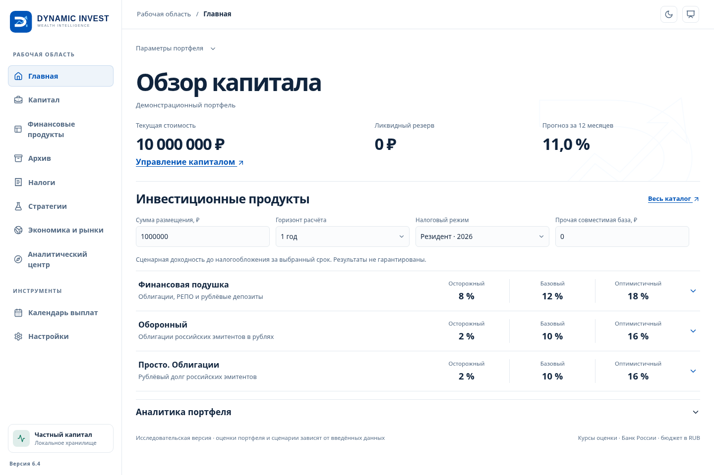

# DYNAMIC INVEST · Private Wealth & Financial Intelligence

DYNAMIC INVEST объединяет учёт частного капитала, финансовую математику и исследование официальных данных. Версия 6.4 Pure White добавляет каталог с аналитическими мини-слайдами. Публикация на [GitHub Pages](https://vladislavly07.github.io/DYNAMIC-INVEST/) выполняется из `main`.



[Мини-слайд на компьютере](docs/screenshots/investment-slides-1440.png) · [На смартфоне](docs/screenshots/investment-slides-360.png) · [Конструктор](docs/screenshots/constructor.png) · [Налоги](docs/screenshots/tax.png) · [Архив](docs/screenshots/archive.png) · [Сценарии](docs/screenshots/strategy.png) · [Презентация](docs/screenshots/presentation.png)

## Что доступно

- Каталог 12 открытых и 4 биржевых фондов УК ПСБ с источниками, историей, комиссиями и составами в пределах раскрытия. Все сценарии используют общую сумму, горизонт и параметры налога.
- Несколько портфелей, ограничение бюджета, сохранение договорных параметров, резервные копии, JSON и CSV.
- Прогноз капитала, календарь выплат, детализация до события и отдельные записи для дохода, переоценки, номинала, комиссии и условного налога.
- Обычные банковские проценты и расчёт НДФЛ 2023–2026. Формулы, исключения и источники доступны в разделе «Налоги».
- Исторические данные ЦБ и 19 банковских наблюдений, включая датированные снимки витрины ПСБ. Дневное воспроизведение портфеля с историческими движениями и импортом JSON.
- Сравнение сценариев, цели, лестница, экран рисков, частная модель консультации, бизнес-воронка и локальный аналитик. Годовые сценарии, сравнение RUB / CNY и выгрузка PDF / XLSX.

## Запуск

Требуется Node.js 24.

```bash
npm ci
npm run dev
npm run lint
npm run typecheck
npm test
npm run build
npx playwright install chromium
npm run test:browser
```

Локальный маршрут `/DYNAMIC-INVEST/`. При наличии системного Chromium можно задать `PLAYWRIGHT_CHROMIUM_EXECUTABLE_PATH`. Переменная `DI_SCREENSHOTS` указывает папку снимков при браузерном прогоне.

## Данные и ограничения

Подтверждённые наблюдения ЦБ отделены от каталога, пользовательских оценок и сценариев. Каталог ПСБ остаётся частичным, новые условия без проверенного интервала действия не публикуются как текущие. В банковской модели нет всех специальных налоговых и договорных правил. [Источники](DATA-SOURCES.md) · [Формулы](FINANCIAL-FORMULAS.md) · [Налоговая методика](TAX-METHODOLOGY.md).

## Сопровождение

[Руководство](USER-GUIDE.md) · [Архитектура](ARCHITECTURE.md) · [Дизайн](DESIGN-SYSTEM.md) · [Безопасность](SECURITY.md) · [Публикация](DEPLOYMENT.md) · [Приёмка](ACCEPTANCE-CHECKLIST.md) · [Статус](IMPLEMENTATION-STATUS.md) · [Продолжение](NEXT-STEPS.md)
